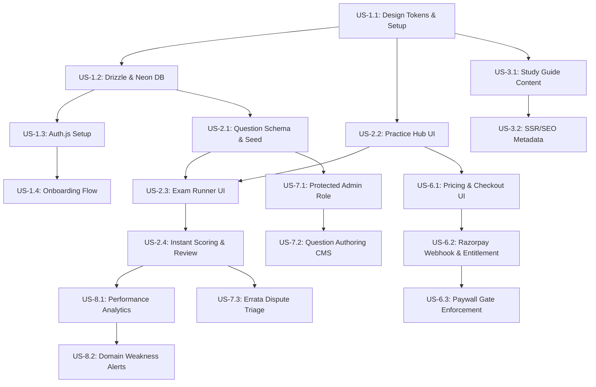

# Agile Delivery Plan — NexusD (Phase 1 MVP)

**Version:** 1.0.0  
**Status:** Approved & Baselined  
**Methodology:** Agile / 2-Week Sprints (Solo Developer Velocity)  
**File Location:** `/DOCS/02-agile-plan/agile-delivery-plan.md`  

---

## 1. Executive Summary & Delivery Strategy

This delivery plan executes the **confirmed Phase 1 MVP Scope** approved at the Step 2.0 gate. It translates the 6 core Phase 1 feature areas into an actionable, sequenced backlog designed for a **solo developer working part-time** (~10–15 hours/week).

### Sprint Cadence & Velocity
* **Sprint Length:** 2 Weeks per sprint.
* **Target Velocity:** 10–14 Story Points per sprint.
* **Total Phase 1 Duration:** 6 Sprints (12 Weeks).
* **Guiding Principle:** Every sprint ends with a demonstrable, vertically integrated slice. Sprint 2 delivers a functional practice test; Sprint 4 adds complete monetization; Sprint 5 delivers a production-ready system with CMS; Sprint 6 executes production deployment on `nexusd.in`, live payment gateway integration, hardened auth, and multi-track telemetry.

---

## 2. Phase Breakdown Overview

### Confirmed Phase 1 MVP Epics
* **Epic 1:** User Accounts & Contextual Onboarding (Foundation)
* **Epic 2:** Practice Engine for Certification Preparations (Core Hook — launching with CSA slice)
* **Epic 3:** Certification Study Blueprints & Domain Guides (SEO & Knowledge Hub — launching with CSA)
* **Epic 6:** Pricing, Razorpay Integration & Access Gates (Monetization)
* **Epic 7:** Admin Content Management System (CMS) (Content Operations)
* **Epic 8:** Performance Telemetry & Domain Analytics (Retention & Value)

### Phase 2 Backlog Outline (Sequenced Post-MVP Launch)
* **Epic 4:** Tailored Career Guidance Roadmaps (Fresher / Switcher / Trainee guides).
* **Epic 5:** 1:1 Mentorship Marketplace (Practitioner profiles, Cal.com/Google Meet scheduling, reviews).
* **Epic 9:** ServiceNow Community (Threaded Q&A, optimistic likes/comments, moderation).
* **Epic 10:** ServiceNow-Exclusive Job Board (Employer & peer referral listings, portfolio applications).
* **Epic 11:** Resume Reality Check (ATS validator cross-referenced with user certifications).
* **Epic 14:** Company-Tagged Interview Question Bank (Deloitte, TCS, Infosys interview rounds).

### Phase 3 Backlog Outline (Scale-Dependent)
* **Epic 12:** Salary & Compensation Transparency (Requires high submission density for statistical anonymity).
* **Epic 13:** Verified-Mentor Badge System (Requires documented project portfolios and active mentor pool).
* **Future Note:** ServiceNow Freelance Marketplace (Long-term exploration only).

---

## 3. Phase 1 Epics & User Story Backlog

*Story points follow Fibonacci sizing: 1, 2, 3, 5, 8, 13. Any story $\ge 8$ includes detailed architectural breakdown.*

---

### Epic 1: User Accounts & Contextual Onboarding
**Epic Goal:** Establish frictionless authentication, session management, and contextual user onboarding (background segment + ServiceNow career tracks) stored cleanly in Neon Postgres via Drizzle ORM.

#### US-1.1: Project Setup, Component System & Design Tokens
* **User Story:** *As a developer, I want a configured Next.js App Router codebase with Tailwind CSS, shadcn/ui, and documented design system conventions, so that all subsequent pages adhere to the Navy/Blue brand identity without visual drift.*
* **Story Points:** **3**
* **Acceptance Criteria:**
  - Next.js 15+ App Router, TypeScript, Tailwind CSS, and shadcn/ui initialized.
  - CSS variables for Navy (`#0B192C`), Electric Blue (`#0066FF`), and Slate neutrals configured in `globals.css`.
  - Component conventions documented in `/DOCS/06-design/component-conventions.md`.
  - Responsive header/nav shell and footer rendered with branding.

#### US-1.2: Database Connection & Schema Setup (Neon + Drizzle)
* **User Story:** *As a developer, I want Drizzle ORM connected to Neon Serverless PostgreSQL with migration tooling, so that the application has a type-safe, sub-millisecond database layer.*
* **Story Points:** **3**
* **Acceptance Criteria:**
  - Connection configured using `@neondatabase/serverless` over HTTP/WebSocket pooling.
  - `drizzle-kit` setup with `npm run db:push` / `npm run db:generate`.
  - Initial `users`, `accounts`, `sessions`, and `verificationTokens` tables created.

#### US-1.3: Authentication with Auth.js (NextAuth v5)
* **User Story:** *As a user, I want to sign up and log in via Google OAuth or Magic Link Email, so that I can securely access the platform without remembering complex passwords.*
* **Story Points:** **5**
* **Acceptance Criteria:**
  - Auth.js v5 route handler configured with Google OAuth provider and Resend/Zoho SMTP Magic Link.
  - Custom branded sign-in dialog/page using shadcn/ui and NexusD navy/accent styling.
  - Session state persisted and accessible across server and client components.

#### US-1.4: Contextual Onboarding Flow (Background & Role Taxonomy)
* **User Story:** *As a newly registered user, I want to select my career background and target ServiceNow roles during onboarding, so that my dashboard and study recommendations are tailored to my goals.*
* **Story Points:** **5**
* **Acceptance Criteria:**
  - Post-signup redirect to `/onboarding` if onboarding is incomplete.
  - Step 1: User selects background segment (`fresher`, `career_switcher`, `servicenow_trainee`).
  - Step 2: User selects target ServiceNow roles from structured taxonomy (`System Administrator`, `Application Developer`, `Technical Consultant / Implementation Specialist`, `Solution Architect`, `Business Analyst`, `Platform Architect`, `Scrum Master / PM`, module specializations: `ITSM`, `ITOM`, `HRSD`, `CSM`, `SecOps`, `GRC`).
  - Stored in structured `user_profiles` table, cleanly decoupled from system security roles.

---

### Epic 2: Practice Engine for Certification Preparations
**Epic Goal:** Provide an ultra-fast, intuitive, and responsive practice engine for certification preparations across ServiceNow credentials (launching with CSA as the initial vertical slice, extensible to CAD, CIS-ITSM, CIS-DF). Supports timed mock exams, untimed practice modes, instant explanations, and question flagging.

#### US-2.1: Practice Question Data Model & Seed Pipeline
* **User Story:** *As a developer, I want a relational schema for certifications, exam domains, questions, options, and attempts, so that questions are cleanly categorized by official blueprints.*
* **Story Points:** **3**
* **Acceptance Criteria:**
  - Drizzle tables: `certifications`, `exam_domains`, `questions`, `question_options`, `user_exam_attempts`, `user_question_answers`.
  - Question model supports: multiple-choice single select, multiple-choice multi-select, question text, detailed explanation, blueprint domain ID, difficulty level.
  - Seed script with 30 high-fidelity CSA questions matching official exam blueprint domains.

#### US-2.2: Practice Hub & Mode Selection UI
* **User Story:** *As a student, I want to visit the CSA certification hub and choose between Timed Exam Mode and Untimed Practice Mode, so that I can study at my own pace or simulate real exam conditions.*
* **Story Points:** **3**
* **Acceptance Criteria:**
  - Public landing page `/certifications/csa` with exam blueprint overview and stats.
  - Mode selection card:
    - **Timed Mock Mode:** 60 questions, 90-minute countdown, score displayed at completion.
    - **Practice Mode:** Instant answer validation and explanation reveal per question.
  - Preview tier: Non-paying users can access 15 free sample questions.

#### US-2.3: Interactive Exam Runner Interface
* **User Story:** *As a student, I want an interactive, mobile-responsive test runner with question navigation, countdown timer, question bookmarking, and clear option selection, so that I have a distraction-free exam experience.*
* **Story Points:** **8**
* **Reasoning for 8 Points:** Complex state management across 60 questions: client-side timer persistence in `localStorage` to survive page reloads, question navigation drawer/grid, flagged question states, multi-select validation, and smooth keyboard/tap navigation.
* **Acceptance Criteria:**
  - Clean question container with full WCAG AA contrast.
  - Fixed header displaying elapsed/remaining time, progress bar, and "Review / Finish" button.
  - Question grid modal/drawer showing Answered (Green), Flagged (Amber), and Unanswered (Neutral).
  - Unsaved progress preserved in `localStorage` in case of accidental browser refresh.

#### US-2.4: Instant Scoring, Pass/Fail Result & Review Engine
* **User Story:** *As a student, I want an instant score report with pass/fail status, domain-by-domain percentage breakdown, and question-by-question review with explanations, so that I understand where I need to improve.*
* **Story Points:** **5**
* **Acceptance Criteria:**
  - Upon submission, score calculated instantly on server route handler.
  - Results page displays: overall percentage, pass/fail status (CSA passing score: 70%), time taken.
  - Domain-wise performance bars matching CSA blueprint areas.
  - "Review Questions" mode showing each question, user's selected choice, correct answer, and rich explanation.

---

### Epic 3: CSA Study Blueprint & Domain Guides
**Epic Goal:** Deliver SEO-optimized, publicly indexable domain-by-domain study guides that establish organic discovery and pair with practice questions.

#### US-3.1: Blueprint Knowledge Architecture & Content Schema
* **User Story:** *As an SEO crawler and user, I want structured study guide pages organized by official CSA domains, so that I can learn core ServiceNow platform concepts systematically.*
* **Story Points:** **3**
* **Acceptance Criteria:**
  - Content structure covering the 5 core CSA domains:
    1. User Interface & Navigation
    2. Collaboration (Task Management, Notifications)
    3. Database Administration (Tables, Schema, Import Sets)
    4. Self-Service & Process Automation (Flow Designer, Service Catalog)
    5. Introduction to Development (Scripting, Client Scripts, Business Rules)
  - Next.js Dynamic Routes: `/study/csa/[domain-slug]`.

#### US-3.2: SSR / SSG Rendering, Dynamic Metadata & Clean URLs
* **User Story:** *As a prospective student searching Google, I want search engines to index high-ranking ServiceNow study guides, so that I discover NexusD organically.*
* **Story Points:** **3**
* **Acceptance Criteria:**
  - All study guide routes statically pre-rendered (`generateStaticParams`) with Incremental Static Regeneration (ISR).
  - Open Graph tags, Twitter cards, meta descriptions, and semantic headings.
  - Automated `sitemap.xml` and `robots.txt` generation via Next.js metadata API.
  - Breadcrumb navigation on all study pages.

---

### Epic 6: Pricing, Razorpay Integration & Access Control
**Epic Goal:** Integrate Razorpay for seamless domestic Indian transactions (UPI, NetBanking, Cards) and enforce access gating for premium mock exams.

#### US-6.1: Pricing Tiers & Checkout Modal
* **User Story:** *As an aspiring developer, I want to view clear, affordable pricing and purchase a CSA Full Mock Pass using UPI or Debit Card, so that I can unlock all full-length mock exams.*
* **Story Points:** **5**
* **Acceptance Criteria:**
  - Transparent pricing display: Free Sample Tier (₹0) vs. CSA Full Exam Pass (e.g., ₹299 / ₹499 one-time).
  - Razorpay Checkout JS SDK integrated.
  - Initiates payment order via Next.js Route Handler `/api/payments/razorpay/order`.
  - Seamless UPI modal popup (Google Pay, PhonePe, Paytm, QR Code).

#### US-6.2: Payment Webhook Processing & Access Entitlement
* **User Story:** *As a developer, I want a secure Razorpay webhook handler that verifies payment signatures and grants user access entitlements, so that purchases are unlocked reliably.*
* **Story Points:** **5**
* **Acceptance Criteria:**
  - Secure webhook endpoint `/api/payments/razorpay/webhook` verifying `x-razorpay-signature` using HMAC SHA256.
  - Stores payment record in `payments` table and updates `user_entitlements` table.
  - Handles edge cases: duplicate webhook delivery idempotency, payment failure alerts.
  - Triggers confirmation email receipt sent from `no-reply@nexusd.in`.

#### US-6.3: Paywall & Access Gate Enforcement
* **User Story:** *As a platform owner, I want full-length mock exams gated so that only users with an active pass can start 60-question tests, while preview questions remain open.*
* **Story Points:** **2**
* **Acceptance Criteria:**
  - Server-side check in Next.js Server Action / Route Handler prior to creating an exam attempt.
  - Unentitled users see an informative upgrade modal when attempting to launch Mock 2, 3, etc.
  - Free sample questions remain open to all registered users.

---

### Epic 7: Admin Content Management System (CMS)
**Epic Goal:** Provide an authenticated internal admin interface for the founder to create, update, and categorize questions, blueprints, and errata without redeploying code.

#### US-7.1: Protected Admin Dashboard & Role Gate
* **User Story:** *As the platform administrator, I want an admin dashboard accessible only by verified admin emails (`admin@nexusd.in`), so that sensitive question authoring is secure.*
* **Story Points:** **2**
* **Acceptance Criteria:**
  - Route protection for `/admin/*` checking `user.role === 'admin'`.
  - Non-admins redirected to `/dashboard` with 403 alert.
  - High-level metric summary: total questions, total attempts, total users, total revenue.

#### US-7.2: Question Authoring & Management Interface
* **User Story:** *As an administrator, I want a clean form to add, edit, tag, and publish practice questions with multiple options and markdown explanations, so that I can expand the question bank effortlessly.*
* **Story Points:** **5**
* **Acceptance Criteria:**
  - List view with search, filter by domain, and difficulty filter.
  - Authoring form: Question text, Domain selector, Single/Multi-select toggle, Option inputs with "Is Correct" toggles, Rich markdown explanation textarea.
  - Validation ensures at least one correct option is selected.
  - Changes instantly reflected in the live practice engine.

#### US-7.3: Errata & Question Dispute Triage
* **User Story:** *As an administrator, I want to view questions reported by students, so that I can quickly fix inaccuracies or update questions matching ServiceNow platform release notes.*
* **Story Points:** **3**
* **Acceptance Criteria:**
  - Exam interface includes a "Report Issue" button opening a small feedback dialog.
  - Submissions saved to `question_reports` table.
  - Admin view `/admin/reports` lists unresolved reports with direct links to edit the question.

---

### Epic 8: Performance Telemetry & Domain Analytics
**Epic Goal:** Give learners actionable insight into their exam readiness, domain strengths, and weak spots to drive study momentum.

#### US-8.1: Student Analytics Dashboard
* **User Story:** *As a student, I want to see my test history, average score, and pass probability indicator, so that I know when I am ready to book the official ServiceNow exam.*
* **Story Points:** **5**
* **Acceptance Criteria:**
  - Dedicated `/dashboard/analytics` view.
  - Overview cards: Total Tests Taken, Average Score %, Best Score %, Time Spent.
  - Readiness Gauge: Visual status indicator (Needs Practice $<65\%$, Approaching Target $65\text{--}75\%$, Exam Ready $>75\%$).

#### US-8.2: Domain Weakness Breakdown & Study Directives
* **User Story:** *As a student, I want to see my percentage accuracy broken down by official CSA domain, with links to the corresponding study guide, so that I know exactly what topics to revise.*
* **Story Points:** **3**
* **Acceptance Criteria:**
  - Bar chart / progress list showing accuracy per domain (e.g., "User Interface: 85%", "Database Administration: 52%").
  - Contextual CTA beside low-scoring domains: "Review Domain Study Guide" linking to `/study/csa/[domain-slug]`.

---

## 4. Sprint Roadmap & Sequence

```
Sprint 1 (Weeks 1-2)  ──>  Sprint 2 (Weeks 3-4)  ──>  Sprint 3 (Weeks 5-6)  ──>  Sprint 4 (Weeks 7-8)  ──>  Sprint 5 (Weeks 9-10) ──> Sprint 6 (Weeks 11-12)
Foundations & Auth         Practice Engine Slice      Study Guides & Analytics    Razorpay Monetization      Admin CMS & Polish         Production Launch & Telemetry
(16 Points)                (19 Points)                (14 Points)                 (12 Points)                (10 Points)                (14 Points)
                                                                                                                                           │
┌──────────────────────────────────────────────────────────────────────────────────────────────────────────────────────────────────────────┘
▼
Sprint 7 (Design System & Revamp) ──> Sprint 8 (Admin Security & Blueprint) ──> Sprint 9 (Dynamic DB Architecture)
Typography Scale, Mock Engine,          Confidential Admin Gateway, Edge Proxy,    Zero-Hardcoded Questions, Neon Importer,
EdTech Dashboard & Profile Portfolio    Role Gating, CIS-DF Blueprint Compliance   Dynamic Profile & Zero-Question States
[US-7.1 to 7.7] (18 Points)             [US-8.1 to 8.6] (16 Points)                [US-9.1 to 9.6] (16 Points)
```

| Sprint | Goal & Demonstrable Deliverable | Stories Committed | Total Points |
| :--- | :--- | :--- | :---: |
| **Sprint 1** | **Foundations, Design System & Auth Context:**<br>Working login with Google/Magic link, contextual onboarding saving user segment and ServiceNow target roles, styled in Navy/Electric Blue. | US-1.1, US-1.2, US-1.3, US-1.4 | **16** |
| **Sprint 2** | **Practice Engine for Certification Preparations (CSA Initial Slice):**<br>Interactive test runner on web/mobile with 30 seeded questions, timed/untimed modes, instant scoring, question bookmarking, and explanation review. | US-2.1, US-2.2, US-2.3, US-2.4 | **19** |
| **Sprint 3** | **Study Blueprints & Student Analytics:**<br>Publicly indexable domain study guides (SSR/SEO) + student performance dashboard with domain weakness breakdown and pass readiness gauge. | US-3.1, US-3.2, US-8.1, US-8.2 | **14** |
| **Sprint 4** | **Razorpay Monetization & Paywall Gates:**<br>Native UPI/Card payment modal for full CSA mock pass, secure webhook verification, email invoice receipt, and access gating. | US-6.1, US-6.2, US-6.3 | **12** |
| **Sprint 5** | **Admin CMS, Errata Triage & Pre-Launch Polish:**<br>Protected CMS to author/edit questions and manage reports without code deploys; SEO/Lighthouse audit, sitemap, final launch readiness. | US-7.1, US-7.2, US-7.3 | **10** |
| **Sprint 6** | **Production Launch, Live Razorpay, Auth Security & Multi-Track Telemetry:**<br>Deploy `nexusd.in` on Vercel, integrate live Razorpay Standard Web Checkout (`checkout.js` + HMAC verification), harden NextAuth/Neon DB with password policy on `/signup`, deliver zero-mock multi-track analytics (`/dashboard/analytics`), and enforce Neon DB single source of truth with Clear Records action. | US-6.1, US-6.2, US-6.3, US-6.4, US-6.5 | **14** |
| **Sprint 7** | **Platform Modernization, Universal Typography Scale, Dynamic Mock Engine & Candidate Portfolio:**<br>Standardize small-to-medium typography scale across 31 routes, implement multi-track mock session protection with Pause/Quit exit interception, 2-Year All-Access Pass (730 days), EdTech dashboard redesign, and candidate resume portfolio. | US-7.1 to US-7.7 | **18** |
| **Sprint 8** | **Confidential Admin Security Perimeter, Role Gating & Blueprint Compliance:**<br>Isolate `/admin` behind dedicated gateway (`/admin/login`), backend administrator auto-seeding without self-registration, Next.js edge middleware interception (`/admin/:path*`), 403 Forbidden layout guard, reserved username registration lockdown, and strict CIS-DF (KB0012913 vs. CIS-Discovery) blueprint metrics. | US-8.1 to US-8.6 | **16** |
| **Sprint 9** | **Dynamic Database Architecture, Zero-Hardcoded Questions & Admin Isolation:**<br>Purge all static questions/options from source code; dynamic candidate profile defaults with user-scoped isolation; eliminate cross-boundary portal links; dynamic `/api/questions` route; Neon DB ingestion script with ServiceNow doc verification protocol; graceful zero-question empty states. | US-9.1 to US-9.6 | **16** |
| **Total** | **Sprint Velocity Delivered Across Sprints 1–9** | **41 Stories** | **135 Points** |

---

## 5. Story Dependencies



---

## 6. Definition of Done (DoD) & Cross-Session Standards

Before any story or sprint is marked complete:
1. **Design System Reuse:** Reuses documented component conventions in `/DOCS/06-design/component-conventions.md`; zero arbitrary one-off CSS.
2. **Performance Budget:** Bundle size impact verified; no render-blocking external scripts; zero N+1 database queries.
3. **SEO Standard:** Public routes prerendered via SSR/SSG with clean URLs and metadata.
4. **Documentation Rule:** Relevant `/DOCS` files updated (sprint log, ADRs, open items) as part of completion.
