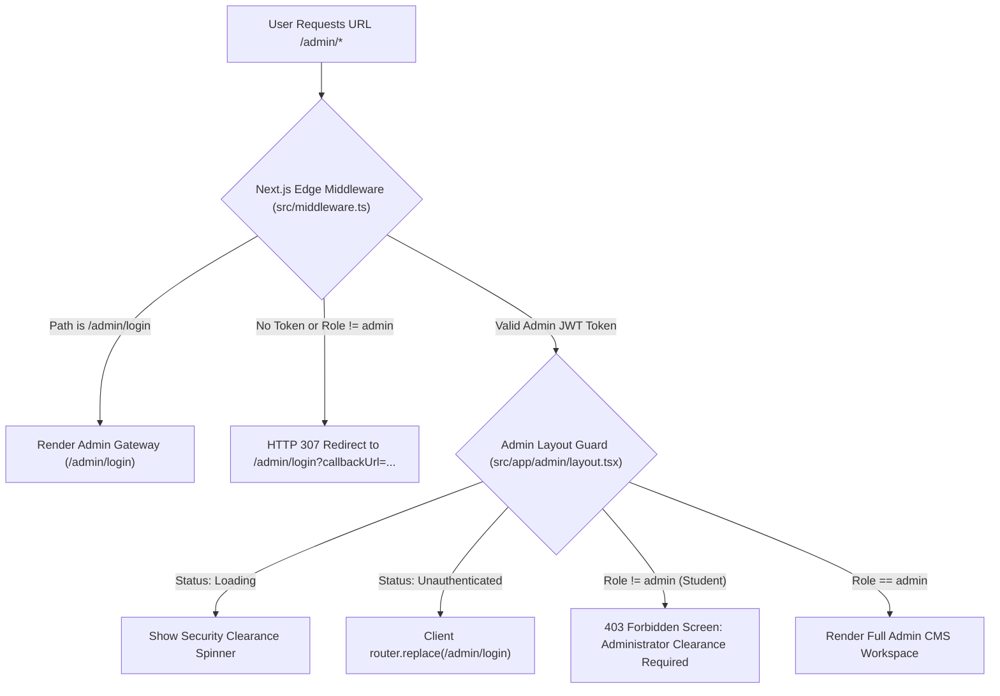

# Confidential Administrator Security & Role Perimeter Architecture

> **System Component:** Platform Administration & CMS Access Control  
> **Target Perimeters:** `/admin`, `/admin/*`, `/admin/login`  
> **Status:** Active & Enforced in Production  
> **Specification Version:** 2026.1.0  

---

## 1. Executive Summary & Security Objectives

The NexusD Administrator Console provides high-privilege operations including:
- Question Bank authoring, key verification, and difficulty calibration.
- Certification track blueprint creation and domain weight governance.
- Student errata disputes and question dispute triage.
- Direct operational telemetry access.

Because these capabilities contain confidential assessment material and system controls, standard student credentials (or unauthenticated sessions) must **never** be permitted to access `/admin` or any of its sub-routes.

### Core Security Objectives
1. **Zero Public Administrator Self-Registration:** There is no registration or sign-up mechanism for administrative accounts in the UI.
2. **Backend-Governed Credentials:** Platform administrator accounts are initialized and governed strictly from backend automation and database seeding.
3. **Dedicated Administrative Gateway (`/admin/login`):** An isolated, high-security entrance detached from regular student authentication.
4. **Immediate URL Challenge:** Any browser attempt to navigate to `/admin` or `/admin/*` without an active administrator session is intercepted and challenged for administrative credentials.
5. **Student Clearance Denial:** Authenticated student sessions attempting to enter `/admin` are intercepted, barred from viewing confidential CMS data, and served a strict 403 Forbidden security barrier.
6. **Defense-in-Depth (Dual-Layer Guard):** Enforcement is executed at both the HTTP/Edge layer (Next.js Middleware) and the React component lifecycle layer (`AdminLayout`).

---

## 2. Multi-Layer Defense Architecture



---

## 3. Detailed Component Specifications

### 3.1 Backend Seeding & Credential Engine (`src/lib/admin-auth.ts`)
- **Authoritative Seeding (`ensureAdminUser()`):** Automatically ensures an administrative user exists in Neon PostgreSQL upon server startup or the first authentication challenge.
- **Bcrypt Hash Security:** Hashes default credentials using bcrypt with 10 salt rounds prior to persistence.
- **Automatic Role Elevation:** If an existing user matches the configured master admin email or username, their role is verified and elevated to `'admin'`.
- **Environment Overrides:**
  - `ADMIN_EMAIL`: Email address for master admin (Default: `admin@nexusd.in`).
  - `ADMIN_USERNAME`: Username for admin login (Default: `admin`).
  - `ADMIN_PASSWORD`: Master administrative password (Default: `AdminNexusD@2026!`).

### 3.2 Public Signup Lockdown (`src/app/signup/actions.ts`)
- **Reserved Identifier Shield:** The public registration endpoint intercepts and blocks any attempt to register using reserved administration handles (`admin`, `administrator`, `root`, `superuser`, or `ADMIN_CONFIG.username`).
- **Reserved Email Protection:** Rejects any registration matching `ADMIN_CONFIG.email`.
- **Role Enforcement:** All public student accounts are explicitly hardcoded to `role: "user"`.

### 3.3 NextAuth Authorization & Session Expansion (`src/auth.ts`, `src/types/next-auth.d.ts`)
- **Flexible Identifier Lookup:** Credentials provider queries PostgreSQL using `or(eq(users.email, identifier), eq(users.username, identifier))`, allowing the administrator to sign in with either their email (`admin@nexusd.in`) or their handle (`admin`).
- **Pre-Auth Seeding:** Calls `await ensureAdminUser()` inside `authorize()` to guarantee that the administrative record is always initialized before verifying credentials.
- **JWT & Session Role Injection:** NextAuth callbacks preserve `token.role` and `session.user.role`, enabling type-safe authorization checks across client and server components.

### 3.4 Next.js Edge Middleware Interception (`src/middleware.ts`)
- **Matcher Configuration:** Binds to `["/admin/:path*"]`.
- **Bypass Route:** Permits `/admin/login` without interception.
- **Token Inspection:** Uses NextAuth `getToken()` to inspect cryptographic session cookies at the edge.
- **Instant Redirection:** If `!token || token.role !== "admin"`, generates an immediate `NextResponse.redirect` to `/admin/login` with `callbackUrl` preservation.

### 3.5 Component Layout Guard & Chrome Isolation (`src/app/admin/layout.tsx`)
- **Bypass on Login:** If `pathname === "/admin/login"`, renders `{children}` directly without administrative navigation or headers.
- **Student Clearance Denial Screen:** If `status === "authenticated"` but `role !== "admin"`, displays a dedicated 403 Forbidden screen:
  - Displays the student's active email.
  - Explains that student accounts cannot access confidential CMS data.
  - Provides a 1-click **Sign In with Administrator Credentials** action (safely signs out and redirects to `/admin/login`).
  - Provides a **Return to Student Dashboard** fallback.
- **Admin Session Chrome:** Authorized administrators receive a dedicated top bar displaying their email, an **Admin CMS** security badge, a **Back to Student Portal** link, and an **Exit Admin** sign-out button.
- **Public Chrome Suppression:** The learner sidebar ([`Sidebar.tsx`](file:///c:/NexusD/src/components/layout/sidebar.tsx)), learner footer ([`Footer.tsx`](file:///c:/NexusD/src/components/layout/footer.tsx)), and responsive margin padding ([`LayoutShell.tsx`](file:///c:/NexusD/src/components/layout-shell.tsx)) automatically unmount when navigating on `/admin/*` routes.

### 3.6 Dedicated Administrator Gateway (`src/app/admin/login/page.tsx`)
- **Design Philosophy:** Dark, enterprise-grade midnight navy aesthetic with perimeter alert badges and terminal icons.
- **Zero Registration Entry:** Strictly omits any "Sign up", "Create account", or registration navigation.
- **Client-Side Student Interception:** If a user logs into `/admin/login` using valid student credentials, the page immediately calls `signOut()`, rejects entry, and warns that only accounts with administrator clearance can proceed.
- **Audit Disclaimer:** Clearly notifies users that all access attempts, timestamps, and IP addresses are recorded.

---

## 4. Operational Runbook: Administrator Login

### Logging In as Administrator:
1. Navigate directly to `/admin` in the browser URL.
2. The edge middleware will intercept the request and redirect to:
   ```
   https://nexusd.in/admin/login?callbackUrl=%2Fadmin
   ```
3. Enter administrator credentials:
   - **Identifier:** `admin@nexusd.in` (or `admin`)
   - **Password:** Configured master password (`AdminNexusD@2026!` default)
4. Click **Authenticate Administrator**.
5. The gateway verifies credentials, confirms `role === "admin"`, and redirects into the Administrator Command Center.

### Exiting Administrator Mode:
1. In the top-right header of the Admin CMS, click **Exit Admin**.
2. The session is invalidated, and the user is redirected back to the `/admin/login` perimeter.

---

## 5. Security Recommendations for Production Hardening

1. **Environment Secret Management:** Ensure `ADMIN_PASSWORD` and `AUTH_SECRET` are stored securely in cloud secret managers (e.g., AWS Secrets Manager, Vercel Environment Variables) and rotated quarterly.
2. **Two-Factor Authentication (2FA):** Integrate TOTP (Time-based One-Time Password via authenticator apps) as an additional gate on `/admin/login`.
3. **IP Range Restrictions:** For enterprise installations, validate `request.headers.get("x-forwarded-for")` in `src/middleware.ts` against authorized corporate CIDR blocks.
4. **Audit Logging Table:** Persist administrative actions (question creations, answer key edits, report resolutions) into an `audit_logs` PostgreSQL table.
